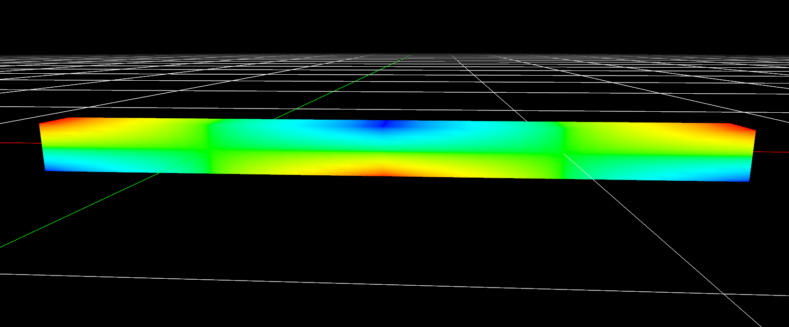
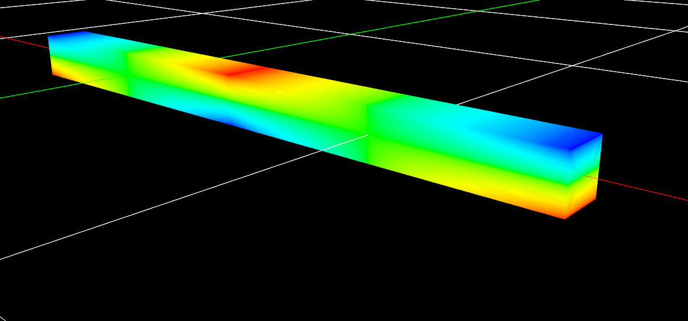

# Beam FEA Solver

A 3D beam finite element solver written in C, with a Vulkan renderer on top
so you can actually see the mesh, loads, and deflected shape instead of
staring at a matrix.

> Work in progress. The full pipeline — parse input → assemble stiffness
> matrix → solve → post-process → render — runs end to end, but it's early
> and still rough in places.

## What it does

- Parses a simple text format for materials, cross-sections, nodes, beam
  elements, distributed loads, and fixed DOFs (`src/parser`).
- Assembles the global stiffness matrix for 3D Euler-Bernoulli beam
  elements and solves it with Gaussian elimination + partial pivoting
  (`src/fea`).
- Post-processes results into per-element internal forces/deflections.
- Renders the mesh and deflected shape through a hand-written Vulkan
  backend (`src/vulkan_backend`) with GLFW for windowing (`src/platform`).

## Layout

```
src/
  app/             entry point, main loop
  platform/        GLFW window + input
  renderer/        render orchestration
  vulkan_backend/  raw Vulkan: instance, device, swapchain, pipeline, etc.
  graphics/        solved geometry -> drawable primitives
  fea/             stiffness matrices, solver, results
  parser/          reads the .fea input format
  core/            file I/O, small utilities
include/           vendored cglm (MIT) math library
shaders/           GLSL source + compiled .spv
assets/            example geometry + sample FEA input
```

## Building (Windows)

You'll need MSVC (`cl.exe` on PATH), the [Vulkan SDK](https://vulkan.lunarg.com/),
and [GLFW](https://www.glfw.org/) 3.4.

1. Set your local SDK paths at the top of `build.bat`:
   ```bat
   set VULKAN_SDK=C:\VulkanSDK\1.4.350.0
   set GLFW_DIR=C:\path\to\glfw-3.4
   ```
2. Compile the shaders once (and again whenever you edit one):
   ```bat
   cd shaders && compile.bat && cd ..
   ```
3. Build:
   ```bat
   build.bat
   ```
4. Run it from inside `build\`:
   ```bat
   cd build && app.exe
   ```
   The app currently resolves its FEA input path relative to the working
   directory, so it needs to be launched from `build\`.

## Input format

`assets/sample.txt` is a working example — materials, sections, nodes,
elements, loads, and fixed nodes. Easiest way to understand the format is
to just read that file.

## Known rough edges

- Single-precision floats throughout the solver.
- Input file path is relative to cwd, not the executable location.
- No tests yet.

## Preview

   
   

## License

TBD.
